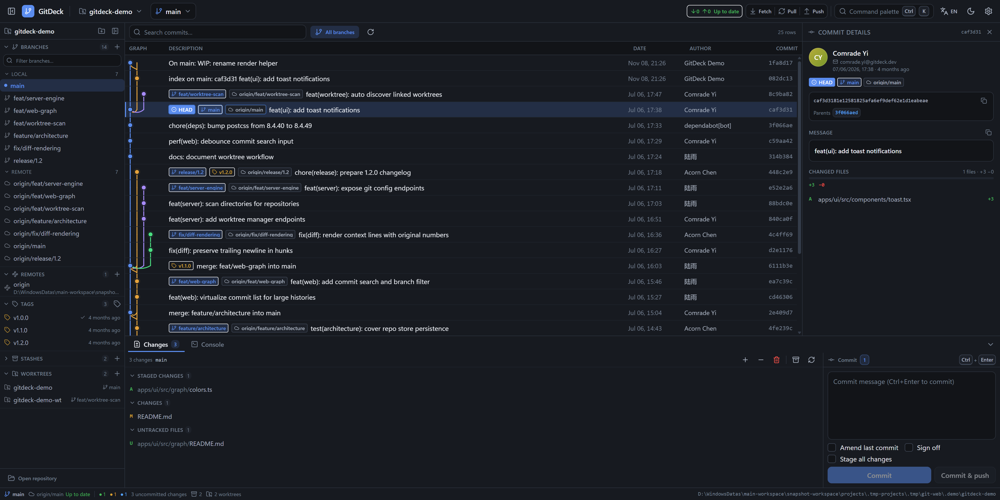
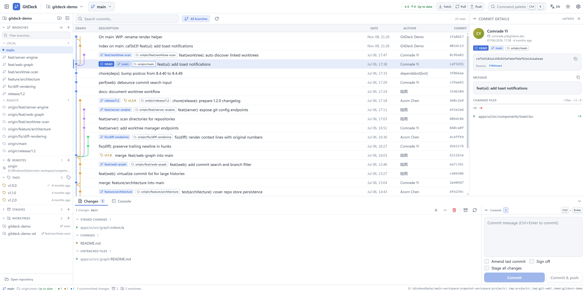
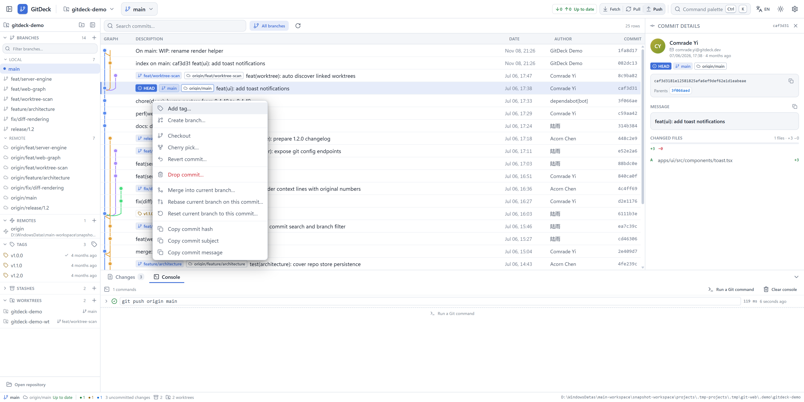
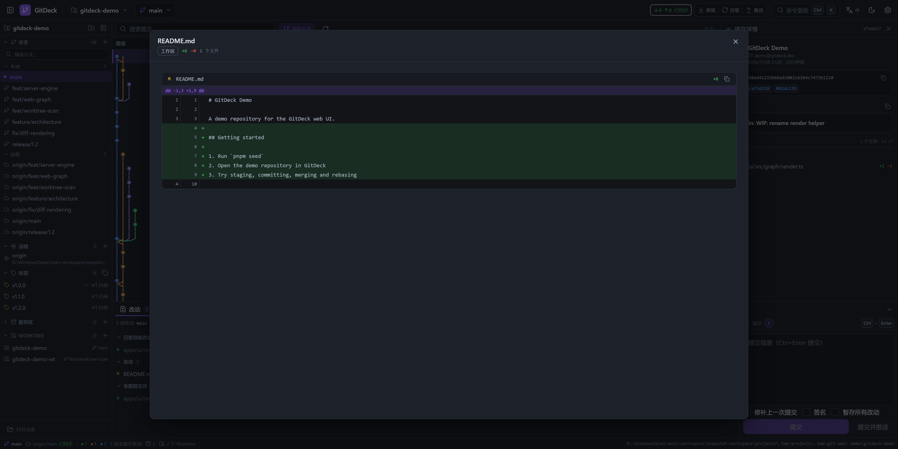
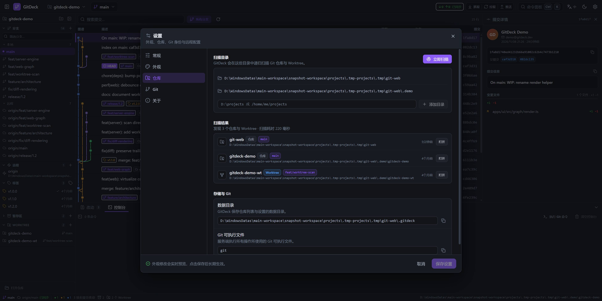
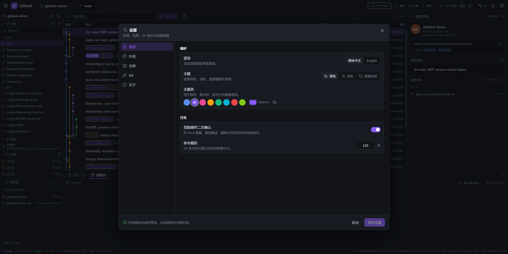

# GitDeck

> A production-grade, cross-platform **web Git GUI** — a GitKraken-style commit graph, first-class
> diffs and staging, every day Git operations, worktree discovery and a transparent command console.
> Built with a pnpm monorepo, Express + the real `git` CLI, and React.

GitDeck gives you the visual clarity of a desktop Git client **plus** the transparency of the CLI:
every action shows the exact `git` command it runs and the raw output it produced.



| Light theme | Commit context menu |
| --- | --- |
|  |  |

| Diff viewer | Worktree auto-scan | Settings & custom accent |
| --- | --- | --- |
|  |  |  |

## ✨ Features

### History & inspection
- **Commit graph** with continuous multi-lane SVG rendering: merge curves, branch convergence,
  stable lane colors, ref pills (local branches, remote branches, tags, HEAD).
- **Commit details** panel: author, dates, hash (copy), message, stats, changed files with
  per-file `+/-` counts and a click-through unified diff viewer.
- **Search & filter** commits by message/author/hash, toggle between current branch and all branches.
- **Context menus** for every ref: checkout, create/rename/delete branch, merge, rebase, push,
  cherry-pick, revert, reset, add tag, copy hash/name, set/unset upstream.
- **Command console**: searchable history of every Git command GitDeck executed, with stdout/stderr,
  exit code, duration and an advanced command runner.

### Working tree
- Stage / unstage / discard per file or in bulk, with confirmation for destructive actions.
- Staged / unstaged / untracked / conflict groups, merge-conflict resolution (keep ours/theirs).
- Commit composer: amend, sign-off, commit & push, `Ctrl+Enter` shortcut.
- Unified diff viewer for working tree, index, commits and ranges; binary/image placeholders.

### Repository operations
- Fetch, pull (merge / rebase / fast-forward-only), push (set upstream, force-with-lease, tags).
- Merge (`--no-ff`, squash), rebase (`--autostash`), cherry-pick, revert, reset (soft/mixed/hard).
- Tags (annotated + lightweight, push to remote), stashes (push/apply/pop/drop/view).
- Remotes: add, edit URLs, rename, remove, fetch and prune.
- Git config editor: user identity, `http.proxy` / `https.proxy`, local or global scope.
- **Worktree manager**: list, create, remove, prune, lock/unlock — plus automatic discovery of
  repositories **and linked worktrees** by scanning configured folders.

### Experience
- **Dark (default) and light themes** with AA-ish contrast, plus **fully custom accent color**
  (presets + color picker), persisted locally.
- **Chinese + English UI** switchable at runtime, persisted locally.
- Desktop-app density: resizable panels, keyboard navigation, command palette (`Ctrl/Cmd+K`),
  toasts, skeletons, empty states, zero layout jank.
- **Cross-platform**: Windows and Linux. No shell interpolation of user input, safe argument arrays,
  UTF-8, long paths, CRLF-safe.

## 🚀 Quick start

Requirements: **Node.js ≥ 20.11**, **pnpm ≥ 10**, **git** on `PATH`.

```bash
pnpm install          # install workspace dependencies
pnpm seed             # create a realistic demo repo (.demo/gitdeck-demo + bare origin + worktree)
pnpm dev              # API on :4319, web app on http://127.0.0.1:5188
```

Open <http://127.0.0.1:5188>. The demo repository is discovered automatically; you can also use
**Scan for repositories** in the welcome screen or settings.

Production build:

```bash
pnpm build            # shared + server (tsup) + web (vite)
node apps/server/dist/index.js   # serves the built web app and the API from :4319
```

### Configuration

| Variable | Default | Description |
| --- | --- | --- |
| `HOST` | `127.0.0.1` | Bind address (keep loopback-only unless behind a trusted proxy) |
| `PORT` | `4319` | API / production web port |
| `GITDECK_HOME` | `<repo>/.gitdeck` or `~/.gitdeck` | Data directory (`repos.json`, `settings.json`) |
| `GIT_BIN` | `git` | Path to the git executable |
| `CORS_ORIGIN` | `http://127.0.0.1:5188,...` | Allowed web origins (comma separated) |
| `COMMAND_TIMEOUT_MS` | `120000` | Hard timeout for a single git command |
| `LOG_LEVEL` | `info` | pino log level |

## 🏗 Architecture

```
pnpm workspace
├── apps/web                React 18 · Vite 5 · Tailwind 3 · TanStack Query · zustand
│   └── src
│       ├── api/            typed fetch client + React Query hooks (single data layer)
│       ├── stores/         UI state (selection, dialogs, command log, filters)
│       ├── features/       shell · graph · changes · dialogs · console · settings · diff
│       ├── components/ui/  design system (buttons, modals, menus, toasts, …)
│       ├── i18n/           zh/en dictionaries + provider (t(key, fallback, params))
│       ├── styles/         semantic CSS tokens, dark/light palettes
│       └── theme/          runtime theme + custom accent engine
├── apps/server             Express 5 · pino · zod · git CLI
│   └── src
│       ├── git/            command runner, argument-safe git service, parsers
│       ├── routes/         REST endpoints (see docs/CONTRACTS.md)
│       ├── store/          repo registry + settings persistence
│       └── scan/           bounded filesystem discovery of repos/worktrees
└── packages/shared         types · zod request schemas · route builders · graph layout algorithm
```

Design decisions:

- **The API is the only way the web app touches Git.** The server owns a repository allowlist and
  validates every request body with zod shared schemas; no user input is ever interpolated into a
  shell string (`spawn` with argument arrays only).
- **One data layer.** All requests go through `apps/web/src/api/hooks.ts`; mutations invalidate the
  repository query namespace and append the executed command to the console.
- **Semantic theming.** Tailwind colors map to CSS variables (`--bg-surface`, `--fg-primary`,
  `--accent`, …), so dark/light/custom accent switch instantly with no rebuild. The commit graph has
  a dedicated `--graph-1..10` palette.
- **Graph layout is pure and tested.** `packages/shared/src/graph.ts` computes lanes, merges and
  convergence with a deterministic algorithm; the web app only renders.

The full REST contract and engineering conventions live in [`docs/CONTRACTS.md`](docs/CONTRACTS.md).

## 🧪 Quality

```bash
pnpm typecheck        # strict TypeScript across all packages
pnpm test             # vitest: graph layout + server integration tests
pnpm build            # production build of every package
pnpm check:i18n       # report missing translations / unused keys
pnpm smoke            # end-to-end REST API smoke test against a running server
```

- Server integration tests create real temporary git repositories (branches, merges, tags, stashes,
  worktrees) and exercise the API end-to-end.
- UI verified in Chrome (no console errors) in dark and light themes, Chinese and English.

## 🌱 Development workflow (git worktrees + agents)

GitDeck itself was built with parallel feature branches in git worktrees:

```
.worktrees/backend   feat/backend-engine   git engine + REST API + tests
.worktrees/core      feat/web-core         shell, commit graph, details, palette
.worktrees/actions   feat/web-actions      changes, diffs, dialogs, console
.worktrees/design    feat/design-system    UI kit, themes, i18n, settings
```

Each branch owns a disjoint set of files (documented in `docs/CONTRACTS.md`), so the branches merge
cleanly into `main`. Run `git worktree list` to see the layout; the app's own worktree panel can be
used to inspect the very worktrees it was developed in.

## 🔒 Security model

- Server binds `127.0.0.1` by default; CORS restricted to the web origin.
- Repository ids are opaque and resolved against a server-side allowlist — no arbitrary path from the
  client is executed against.
- All git invocations use argument arrays with `shell: false`; zod validates ref names, paths and
  scopes.
- The `exec` endpoint is constrained to an allowlisted set of git subcommands and is intended for
  experienced users; destructive UI actions require confirmation.

## 📄 License

Private / internal demo project. Third-party dependencies keep their respective licenses.
